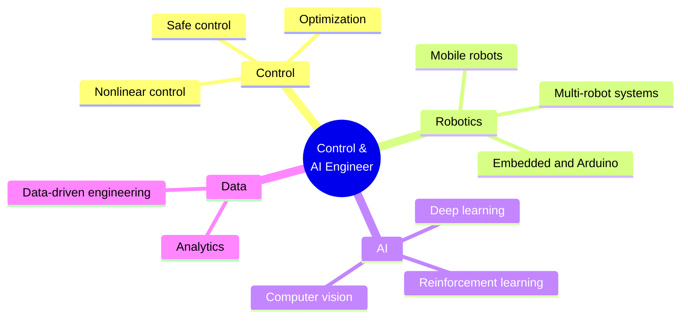
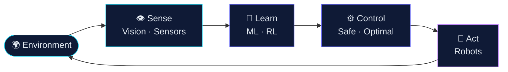

<!-- Animated hero banner (assets/banner.svg) -->

 

  

 

## ⚡ At a Glance

<table>
<tr>
<td width="50%" valign="top">

**🎓 Education**
Iran University of Science and Technology (IUST)
*Electrical Engineering — Control*

**🔬 Current Research**
Decentralized and Safe Formation Control for Differential-Drive Mobile Robots with Minimal Sensing

</td>
<td width="50%" valign="top">

**🧭 Focus**
AI-enhanced autonomy, decision-making and real-world intelligent engineering systems

**🌱 Exploring**
Reinforcement Learning · Multi-Agent Systems · Computer Vision

</td>
</tr>
</table>

## 👋 About Me

I'm an **Electrical Engineer specializing in Control**, a graduate of **IUST**. I work where **control theory meets artificial intelligence**, building systems that perceive their environment, make decisions, and act reliably in the real world.

> 🛰️ **Research spotlight**: *Decentralized and Safe Formation Control for Differential-Drive Mobile Robots with Minimal Sensing*, studying how teams of robots can coordinate safely using only limited sensing, while exploring how AI strengthens autonomy and decision-making.

## 🔬 Research Focus

 

The robots I study are **differential-drive (unicycle-type) mobile robots**, whose kinematics are

$$
\dot{x}_i = v_i \cos\theta_i, \qquad \dot{y}_i = v_i \sin\theta_i, \qquad \dot{\theta}_i = \omega_i
$$

and the challenge is to steer a whole team into formation **without a central coordinator**, **without collisions**, and with **as little sensing as possible**.

<table>
<tr>
<td align="center" width="33%">
<h3>🕸️ Decentralized</h3>
Every robot decides locally, so there is no single point of failure and the team scales.
</td>
<td align="center" width="33%">
<h3>🛡️ Safe</h3>
Formal guarantees that robots keep their distance while converging to the formation.
</td>
<td align="center" width="33%">
<h3>📡 Minimal Sensing</h3>
Doing more with less information, which means cheaper and more robust hardware.
</td>
</tr>
</table>

## 🗺️ Areas of Expertise

<table align="center">
<tr>
<td align="center" width="33%">
<h2>🤖</h2>
<b>Robotics & Autonomous Systems</b> 
Mobile robots · navigation · multi-robot coordination
</td>
<td align="center" width="33%">
<h2>⚙️</h2>
<b>Control & Optimization</b> 
Intelligent, nonlinear and safe control design
</td>
<td align="center" width="33%">
<h2>🧠</h2>
<b>AI & Machine Learning</b> 
Deep learning · reinforcement learning
</td>
</tr>
<tr>
<td align="center">
<h2>👁️</h2>
<b>Computer Vision</b> 
Perception for autonomous systems
</td>
<td align="center">
<h2>📊</h2>
<b>Data Science & Analytics</b> 
Data-driven engineering decisions
</td>
<td align="center">
<h2>🌍</h2>
<b>Intelligent Engineering</b> 
AI-powered real-world solutions
</td>
</tr>
</table>

## 🔄 How I Think About Systems

## 🚀 Featured Projects

 

| Project | What it does | Stack |
|:--|:--|:-:|
| 🐛 **[RL Crawling Robot](https://github.com/DariushKhosrowan/RL_Crawling_Robot)** | A worm-like robot that learns to crawl through reinforcement learning, on Arduino and servo motors | `C++` `Arduino` `RL` |
| 🚗 **[Car Detection · YOLOv8](https://github.com/DariushKhosrowan/CarDetection_yolov8)** | Detects and counts cars in parking lots from aerial images with a trained model | `Python` `YOLOv8` |
| ♟️ **[Othello AI · MiniMax](https://github.com/DariushKhosrowan/Othello-AI-MiniMax)** | Othello / Reversi with a MiniMax opponent, a pygame GUI and a standalone Windows executable | `Python` `pygame` |
| 🔢 **[ANN Digit Recognition](https://github.com/DariushKhosrowan/ANN-Handwritten-Digit-Recognition)** | Handwritten digit recognition with an artificial neural network, built for an AI course | `Python` `ANN` |
| 🧪 **[Student Depression Detection](https://github.com/DariushKhosrowan/student-depression-detection)** | Decision-tree classification with data preprocessing in Python | `Python` `scikit-learn` |

## 🔭 Current Interests

 

## 🛠️ Languages & Tools

&nbsp;&nbsp;
&nbsp;&nbsp;
&nbsp;&nbsp;
&nbsp;&nbsp;
&nbsp;&nbsp;

  
&nbsp;&nbsp;
&nbsp;&nbsp;
&nbsp;&nbsp;
&nbsp;&nbsp;
&nbsp;&nbsp;

  
&nbsp;&nbsp;

## 💼 Selected Experience

| | Role | Organization |
|:-:|:--|:--|
| 📈 | **Research & Data Assistant** | Lotus Futurists |
| 👁️ | **Computer Vision Research Intern** | CVLab, IUST |
| 🎓 | **Teaching Assistant** — Artificial Intelligence, Industrial Control Lab, Programming | IUST |
| 🎙️ | **Founder & Host** | EnglishConvey |

## 📊 GitHub Analytics

 

 

 

  

<!-- Contribution snake: generated by .github/workflows/snake.yml into the `output` branch -->
<picture>
  <source media="(prefers-color-scheme: dark)" srcset="https://raw.githubusercontent.com/DariushKhosrowan/DariushKhosrowan/output/github-snake-dark.svg"/>
  <source media="(prefers-color-scheme: light)" srcset="https://raw.githubusercontent.com/DariushKhosrowan/DariushKhosrowan/output/github-snake.svg"/>
  
</picture>

## 🤝 Let's Build Something Intelligent

Open to research collaborations, robotics, control and AI engineering opportunities.

  

### *"The future belongs to systems that can sense, learn, adapt, and collaborate."*

